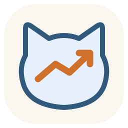
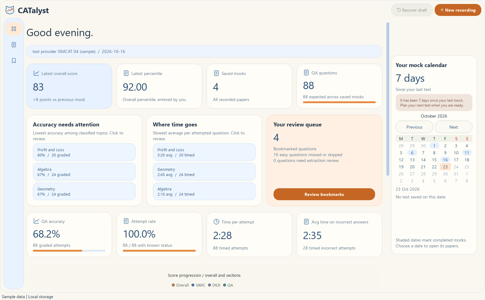
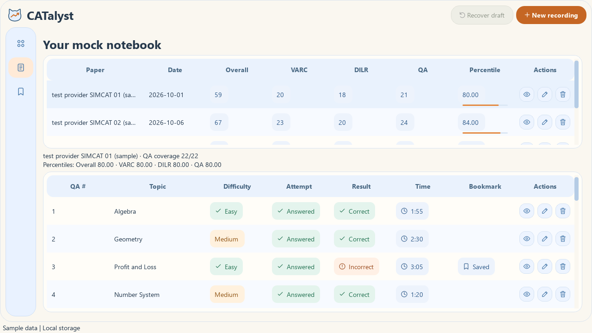
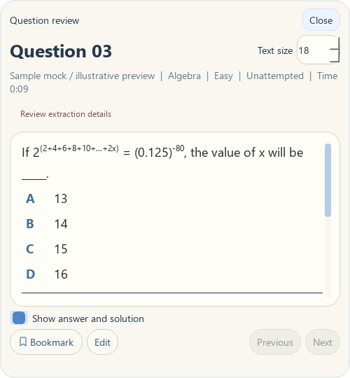

<p align="center">
  
</p>

<h1 align="center">CATalyst</h1>

<p align="center">A local notebook for your CAT mocks, questions and progress.</p>
<p align="center"><strong>Windows desktop ? Offline OCR ? Local storage</strong></p>

<p align="center">
  <a href="#get-started">Get started</a> ?
  <a href="#screenshots">Screenshots</a> ?
  <a href="#review-a-mock">User guide</a> ?
  <a href="#troubleshooting">Troubleshooting</a> ?
  <a href="#development">Development</a>
</p>

CATalyst captures QA questions while you browse your completed mock's review pages. Correct the extracted details, save questions by paper, bookmark difficult ones and track your scores over time.

| Capture | Review | Track |
| --- | --- | --- |
| Automatic capture with pause/resume | Editable questions, answers and text solutions | Overall and sectional scores and percentiles |
| Compressed image fallbacks for difficult text | Compact reader and bookmarked questions | Topic accuracy, time analysis and mock calendar |

## Get started

**No Python installation is needed to use the executable.**

1. Open [GitHub Releases](https://github.com/pandey-ishan/CATalyst/releases) and download `CAT-Analyst.exe` from an available release.
2. Double-click the executable. Its OCR models are included; normal use works offline.
3. Open your completed mock in your browser and follow [Review a mock](#review-a-mock).

If no release is available yet, use the repository's **Actions ? Windows executable ? Run workflow** to build one, or follow the [local build instructions](#development). Workflow artifacts need to be extracted before running the executable.

The first launch can take a few seconds while the bundled runtime extracts. The executable is unsigned, so Windows may show a publisher warning. Updating the executable does not remove saved papers.

## Screenshots

Actual app views rendered with **sample data**, not personal mock records. Click an image to view it at full size.

### Dashboard

Topic weaknesses, timing, accuracy and a calendar of saved mocks.

[](docs/screenshots/dashboard.png)

<details>
<summary><strong>Paper library and question reader</strong></summary>

Compare saved papers and review their questions using the row actions.

[](docs/screenshots/papers.png)

Read questions in a compact window with adjustable text, answer reveal and bookmarks.

[](docs/screenshots/question-review.png)

</details>

<details>
<summary><strong>Add or replace screenshots</strong></summary>

Save app screenshots in `docs/screenshots/`. Replace `dashboard.png`, `papers.png` or `question-review.png` to update the gallery without changing its links.

To add another view, save a PNG such as `recording.png` and insert:

```markdown

```

Use sample records or hide personal information before committing images. Relative paths work both in the repository and on GitHub. Preview this file in VS Code with **Ctrl+Shift+V**.

</details>

## Review a mock

1. **Prepare the browser.** Open the completed test's QA review on your primary display.
2. **Select the capture area.** Click **New recording**, then drag around the question and review panel. Include the question counter (for example, `01/22`), all options and any answer tick. Keep the recording notch outside the rectangle.
3. **Browse normally.** Visit every QA question, including unattempted ones. Open both **Statistics** and **Text Solution** yourself. Hold each view steady until the recording controls confirm capture.
4. **Check the extraction.** Open **Review ? View question** during recording. Edit incorrect or missing text, topic, difficulty, answers, attempt status or time. Manually edited fields are protected from later OCR updates.
5. **Save the paper.** Click **Stop & save**. Enter the name, test date, overall and VARC/DILR/QA scores and percentiles. Check the question count and acknowledge any incomplete coverage.
6. **Return to difficult questions.** Use **Papers** to review saved questions and **Bookmarks** to keep a revision list.

**Pause whenever needed.** The app captures automatically while you browse; it does not navigate the website. Capture also pauses while CATalyst has focus and continues when you return to the browser. The recording notch collapses after four seconds; hover over it to expand.

**Canceled or interrupted saves:** use **Recover draft** to review, save or resume the retained session. Temporary recordings are deleted only after a successful save.

## What is saved?

| Information | How it is collected |
| --- | --- |
| QA questions, answers and text solutions | Local OCR, with editable results |
| Difficulty, attempt status, correctness and time | Extracted from the visible review page |
| Topic | Suggested locally; can be changed manually |
| Overall and all three sectional scores/percentiles | Entered by you when saving |
| Difficult question or solution images | Automatic cropped, losslessly compressed PNG fallback |
| Full capture screenshots | Optional; off by default |

Identical fallback images are deduplicated. Question images appear in the reader; solution images appear when you select **Show answer and solution**. Detection is heuristic and may miss confident OCR errors. VARC/DILR questions and video solutions are outside the current scope.

The dashboard calculates accuracy from graded attempted questions. Skipped questions do not count as incorrect; unknown results and times are excluded. Timing describes time spent answering the mock, not time spent recording or reviewing.

## Local data and backups

Data stays in `%LOCALAPPDATA%\CATAnalyst` by default.

| Location | Contents |
| --- | --- |
| `analyst.sqlite3` | Saved papers, questions, scores, bookmarks and retained images |
| `sessions/<id>/draft.json` | Unfinished session details |
| `sessions/<id>/` | Temporary recording and image files until saving succeeds |

To back up your work, close CATalyst and copy this folder. Set `CAT_ANALYST_DATA` before launching to choose a different directory. Saved data is not encrypted; a synced folder may be uploaded by your sync software, although CATalyst itself does not upload data.

## Troubleshooting

| Problem | What to check |
| --- | --- |
| Review is empty | Keep the browser on the primary screen. Include the visible question number inside the capture area and return focus to the browser. |
| Some questions are missing | Hold each view steady, keep the counter visible and check coverage before saving. Add missing questions manually if needed. |
| Equations or answers look wrong | Inspect the image fallback and edit the text. Include the full option and its answer tick in the capture area. |
| Browser moved after capture started | Stop and retain the draft, then resume with a newly selected capture area. |
| A recent fix is not showing | Close and restart the app. Previously saved OCR text is not automatically reprocessed; edit or recapture it. |

**Current limits:** capture supports the primary monitor and requires a recognized question number. Complex fractions, exponents, dense layouts and long scrolling explanations can still need correction. A green tick identifies the correct answer, not necessarily the option you selected. Topic suggestions should also be checked. Live provider coverage and clean-machine executable behavior are not fully validated.

## Development

Users of the executable can skip this section. Source builds require **Windows x64 and Python 3.11**. Installing dependencies requires internet access; running the app does not.

<details>
<summary><strong>Run from source</strong></summary>

Run from the repository root in PowerShell:

```powershell
py -3.11 -m venv .venv
.\.venv\Scripts\python.exe -m pip install -r requirements.txt
.\.venv\Scripts\python.exe -m cat_analyst
```

After setup, `Start-CAT-Analyst.bat` also launches the app.

</details>

<details>
<summary><strong>Build the Windows executable</strong></summary>

After creating the virtual environment above:

```powershell
.\.venv\Scripts\python.exe -m pip install pyinstaller==6.16.0
.\build.ps1
```

Outputs: `release/CAT-Analyst.exe` and `release/SHA256SUMS.txt`.

`build.ps1` bundles dependencies and OCR models, creates the Windows icon from the SVG logo and runs an offline executable smoke check. PyInstaller's `.spec` recipe is generated in ignored `build/`; it does not need separate maintenance. Committing the PowerShell script does not execute it.

For GitHub builds, run **Windows executable** from Actions. Pushing a version tag such as `v0.1.0` triggers the workflow to test, build and publish release assets. Keep binaries in Releases rather than Git source history.

</details>

<details>
<summary><strong>Tests and sample screenshots</strong></summary>

```powershell
.\.venv\Scripts\python.exe -m unittest discover -s tests -v
.\.venv\Scripts\python.exe -m tests.ocr_smoke
.\.venv\Scripts\python.exe -m tests.math_smoke
.\.venv\Scripts\python.exe -m tests.render_previews
.\.venv\Scripts\python.exe -m pip check
```

Tests use synthetic data and temporary storage. OCR smoke checks use generated images; they do not read your screen. Preview images are written to `_test_artifacts/`; copy the views you want into `docs/screenshots/` to update this README's gallery.

</details>

<details>
<summary><strong>Project layout</strong></summary>

| Path | Purpose |
| --- | --- |
| `cat_analyst/` | Desktop UI, capture, OCR parsing, analytics and local storage |
| `cat_analyst/assets/logo.svg` | Shared app and executable logo |
| `tests/` | Regression tests and synthetic previews |
| `docs/screenshots/` | README gallery images |
| `build.ps1` | Executable build and smoke check |
| `.github/workflows/windows-release.yml` | GitHub build and release workflow |
| `build-docs/` | Local requirements, Q&A and project memory; ignored by Git |

</details>

[Back to top](#catalyst)
